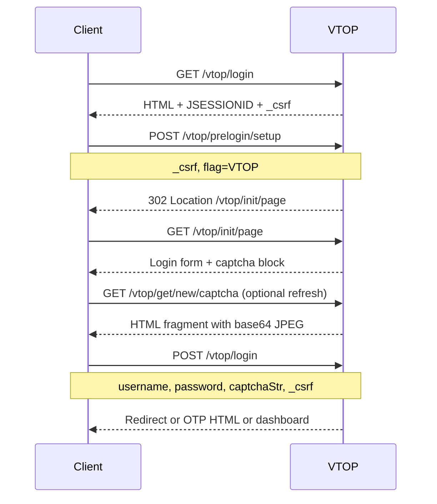

# VTOP API map — VIT Vellore (`vtop.vit.ac.in`)

Discovery date: **2026-10-27** (Milestone 1). Method: live HTTP probing with
browser-like `User-Agent` (no credentials stored in this repo).

## Base URL and security

| Item | Value |
|------|--------|
| Host (allowlist) | `vtop.vit.ac.in` |
| Base URL | `https://vtop.vit.ac.in` |
| App prefix | `/vtop` |
| TLS | Standard HTTPS; certificate verification required |
| Session cookies | `JSESSIONID` (path `/vtop`, HttpOnly, Secure), `SERVERID` |

Requests without a browser-like User-Agent may receive **403** on `/vtop/login`.

## CSRF

Spring-style CSRF token embedded in HTML forms:

- Hidden input: `name="_csrf"` `value="<uuid>"`
- Must be sent on POST for prelogin, login, OTP, and authenticated actions
- Token rotates per page load; read from the current HTML before each POST

## Login flow (student)



### Step 1 — Landing

| | |
|---|---|
| **Method / path** | `GET /vtop/login` |
| **Purpose** | Role selection (Student / Employee / Parent / Alumni) |
| **Response** | HTML; sets `JSESSIONID` |
| **CSRF** | In each role form (`stdForm`, etc.) |

Student form (`id=stdForm`):

| Field | Value |
|-------|--------|
| `action` | `/vtop/prelogin/setup` |
| `method` | `POST` |
| `_csrf` | from page |
| `flag` | `VTOP` |

### Step 2 — Prelogin setup

| | |
|---|---|
| **Method / path** | `POST /vtop/prelogin/setup` |
| **Content-Type** | `application/x-www-form-urlencoded` |
| **Body** | `_csrf`, `flag=VTOP` |
| **Success** | `302` with `Location: /vtop/init/page` |
| **Note** | Do not follow POST with wrong cookie jar; use same session for redirect GET |

### Step 3 — Login page

| | |
|---|---|
| **Method / path** | `GET /vtop/init/page` |
| **Purpose** | Username / password / captcha form |
| **Form** | `id=vtopLoginForm`, `action=/vtop/login`, `method=POST` |

| Field | Name | Notes |
|-------|------|--------|
| CSRF | `_csrf` | Hidden |
| Username | `username` | Max 15; uppercased in UI |
| Password | `password` | |
| Text captcha | `captchaStr` | Max 6; uppercased in UI |

Inline JavaScript defines captcha mode:

| `captchaType` | Meaning |
|---------------|---------|
| `1` | Built-in image captcha (`callBuiltValidation`) |
| `2` | Google reCAPTCHA (`callGoogleValidation`, `g-recaptcha-response`) |

**Retry strategy (v1):** Re-run steps 1–3 (new session or refresh) until
`captchaType === 1` and `#captchaBlock` contains an image, or cap retries.

### Step 4 — Captcha refresh

| | |
|---|---|
| **Method / path** | `GET /vtop/get/new/captcha` |
| **Response** | `text/html` fragment (not raw image bytes) |
| **Parse** | `` inside fragment |

Initial captcha is often already embedded in `/vtop/init/page` `#captchaBlock`.

### Step 5 — Login submit

| | |
|---|---|
| **Method / path** | `POST /vtop/login` |
| **Content-Type** | `application/x-www-form-urlencoded` |
| **Body** | `_csrf`, `username`, `password`, `captchaStr` (when built-in captcha) |

**Success signals (to implement in M4):**

- Redirect to post-login dashboard (e.g. `/vtop/open/page` or home shell)
- Set/update session cookies
- HTML may include `authorizedID` hidden field for subsequent POSTs

**Failure signals:**

- Same login box with error message
- Invalid captcha → retry captcha + submit

### Step 6 — OTP (conditional)

Observed XHR endpoints on login page (used after login or forgot-password flows):

| Method | Path | Purpose |
|--------|------|---------|
| POST | `/vtop/generateOtp` | Request OTP |
| POST | `/vtop/validateOtp` | Submit OTP |
| POST | `/vtop/resendOtp` | Resend OTP |

Form fields for OTP steps are returned as HTML fragments; exact field names
must be parsed from the OTP form in M4 (`otpVerificationForm` pattern).

## Post-login session

Authenticated VTOP web apps typically require on each read POST:

| Field | Description |
|-------|-------------|
| `authorizedID` | Session authorization token from post-login HTML |
| `_csrf` | Current CSRF token |
| `semesterSubId` | Semester identifier for semester-scoped views |

Obtain `authorizedID` and semester list from the first authenticated HTML/JSON
response in M4 (often semester dropdown on attendance or timetable page).

## Read endpoints (platform-standard)

Paths below match the **VIT VTOP platform** used across campuses. Relative to
`https://vtop.vit.ac.in`. **Response parsing is Milestone 4–6**; paths are
candidates for the M3 allowlist after login verification.

| Feature | Method | Path | Typical POST fields |
|---------|--------|------|---------------------|
| Profile | POST | `/vtop/studentsRecord/StudentProfileAllView` | `verifyMenu`, `authorizedID`, `_csrf`, `nocache` |
| Semester list | POST | `/vtop/academics/common/StudentAttendance` | `verifyMenu`, `authorizedID`, `_csrf`, `nocache` |
| Attendance | POST | `/vtop/processViewStudentAttendance` | `authorizedID`, `_csrf`, `semesterSubId`, `x` |
| Timetable shell | POST | `/vtop/academics/common/StudentTimeTable` | menu fields |
| Timetable data | POST | `/vtop/processViewTimeTable` | `semesterSubId`, `x` |
| Marks shell | POST | `/vtop/examinations/StudentMarkView` | menu fields |
| Marks data | POST | `/vtop/examinations/doStudentMarkView` | `semesterSubId` |
| Exam shell | POST | `/vtop/examinations/StudExamSchedule` | menu fields |
| Exam data | POST | `/vtop/examinations/doSearchExamScheduleForStudent` | `semesterSubId` |
| Grades shell | POST | `/vtop/examinations/examGradeView/StudentGradeView` | menu fields |
| Grades data | POST | `/vtop/examinations/examGradeView/doStudentGradeView` | `semesterSubId` |
| Courses (MCP) | POST | `/vtop/processViewTimeTable` | course list table in response |
| Calendar | POST | `/vtop/processViewCalendar` | `calDate`, `semSubId`, `classGroupId`, `x` |
| Spotlight | POST | `/vtop/home` | menu fields |
| HOD / Dean | POST | `/vtop/hrms/viewHodDeanDetails` | menu fields |
| Faculty search | POST | `/vtop/hrms/EmployeeSearchForStudent` | `empId`, `x` |
| Proctor | POST | `/vtop/proctor/viewProctorDetails` | menu fields |

Responses are predominantly **HTML tables**; some endpoints return partial HTML
for AJAX. Parsers should not assume JSON.

## Spotlight

Post-login dashboard (`POST /vtop/home`) lists SPOT-LIGHT items. Downloads use
`vtopDownload('downloadSpotLightViewFile/{id}')`; external links use normal
`href` URLs.

## Legacy ASP (deprecated for v1 client)

Older integrations used:

- `https://vtop.vit.ac.in/student/stud_login.asp`
- Captcha: `#imgCaptcha` image URL
- Fields: `regno`, `vrfcd`, `passwd`

The current **`/vtop/login` SPA-style flow** above replaces this for new
students. Do not target ASP endpoints in v1 unless rediscovery proves otherwise.

## v1 permanent exclusions

Never register MCP/client operations for:

- Course registration / add-drop
- Fee payment
- Profile edit / password reset / forgot userid flows
- Outing save / hostel mutations

See `EXCLUDED_PATH_PATTERNS` in [`src/vtop_mcp/vtop/constants.py`](../src/vtop_mcp/vtop/constants.py).

## Local probing

Run (no credentials; prints status codes and redirect targets only):

```bash
uv sync
uv run python scripts/discovery_probe.py
```

Expected healthy output includes `POST /vtop/prelogin/setup -> 302` with
`location='/vtop/init/page'` (or absolute URL on the same host). A `200` back to
`/vtop/login` usually means CSRF or cookie mismatch — retry with a fresh session.

Do not commit probe output containing cookies or CSRF values.

## References

- Live probe: `/vtop/login`, `/vtop/prelogin/setup`, `/vtop/init/page`, `/vtop/get/new/captcha`
- Community: [VIT-Scraper](https://github.com/rishav394/VIT-Scraper) (Vellore),
  [vtop_py_scraper](https://github.com/achyutbadyal/vtop_py_scraper) (path naming),
  [VtopMCP](https://github.com/Vikranth-jagdish/VtopMCP) (Chennai; same POST patterns)
